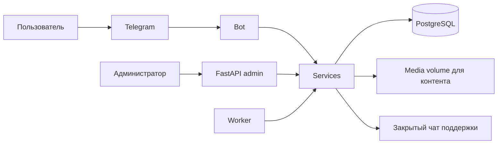

# Архитектура Telegram-бота «Нулевой семестр»

Статус: архитектура согласована; тексты контента и даты рассылок заполняются позже через админку.

## 1. Что строим

Один репозиторий и одно Python-приложение с тремя отдельно запускаемыми частями:

1. Telegram-бот на aiogram 3.
2. FastAPI-админка.
3. Worker для рассылок, напоминаний, PDF и очистки старых файлов.

Все три части используют одну PostgreSQL и общий код бизнес-логики. Это модульный монолит, не микросервисы.



Схема показывает только, кто с кем общается. Отдельного компонента «контекст системы» в коде нет.

## 2. Утвержденные решения

- Python 3.12.
- PostgreSQL — источник контента, пользователей, прогресса и аналитики.
- FastAPI-админка полностью заменяет Google Sheets как CMS.
- Статистика выгружается в XLSX/CSV для последующей загрузки в Google Sheets.
- Количество и порядок модулей обеих школ задаются через админку. Для первого наполнения Школы технологий будет создано 15 модулей, но это не ограничение в коде.
- Правило завершения курса задается настройками запуска; по текущему ТЗ курс завершен после прохождения всех обязательных опубликованных модулей выбранной школы.
- Максимальное количество попыток квиза задается в админке для конкретной практики; начальное значение — две попытки.
- Практика бывает `quiz` или `open_question`; отдельного poll в MVP нет.
- Деплой — Docker Compose с PostgreSQL volume и media volume для оригиналов контента. Kubernetes, Redis и S3 для ожидаемой нагрузки примерно до 800 пользователей не нужны.
- Админские роли: `admin`, `content_manager`, `support`.
- Поддержка доступна через админку и Telegram-группу.
- PDF с ответами на открытые вопросы отправляется пользователю после завершения курса.
- Тексты и даты рассылок заполняются через админку, а не зашиваются в код.

## 3. Состояния контента

- `draft` — администратор редактирует материал, пользователи его еще не видят.
- `published` — материал опубликован и бот показывает его пользователям.
- `archived` — старый модуль или ежегодный запуск скрыт, но его прогресс и статистика не удалены.

Например, методист создает модуль в `draft`, загружает карточки, проверяет предпросмотр и нажимает «Опубликовать». Только после этого модуль появляется в боте.

## 4. Пользовательские сценарии

### Регистрация

`/start` → ввод Time login → выбор школы → подтверждение → меню.

Допустимые примеры: `@e.p.kuznetsov`, `@o.kostin`, `@a.zubkov`, `@e.kuznetsov`.

Формат Time login не проверяем регулярным выражением: реальные логины могут иметь разные структуры, цифры и разное количество частей. Проверяем только, что введена непустая строка разумной длины, убираем пробелы по краям и сохраняем значение. Храним Telegram ID, Time login, школу и дату регистрации. Telegram first name используем для приветствия, но в БД не сохраняем.

Школу меняет администратор. Прогресс школ хранится отдельно: после перехода из дизайна в технологии пользователь начинает технологический сценарий с нуля; после возврата в дизайн снова видит прежний дизайн-прогресс.

### Модуль

Статус каждого модуля: `not_started`, `in_progress`, `completed`.

Для продолжения сохраняются:

- просмотрен ли вступительный кружок;
- ID текущего поста;
- номер текущей карточки;
- начата ли практика.

Команда `/menu` прекращает текущий режим ожидания текста — например, ожидание ключа или открытого ответа, — но не удаляет прогресс и номер карточки.

Кружок отправляется как Telegram video note по `file_id`. Оригинал кружка хранится в media volume. Если Telegram запрещает пользователю получать кружок, бот отправляет сохраненный оригинал как обычное видео; полученный `video_file_id` затем кэшируется в БД для следующих отправок.

### Практика

- Любой ответ завершает модуль.
- Квиз сохраняет выбранный вариант, правильность и номер попытки.
- После ответа показывается правильный ответ и объяснение.
- Для текущего курса в настройке практики выставляются две попытки; код не привязан к этому числу.
- Открытый ответ сохраняется для пользовательского PDF и административной статистики.

### Секретный ключ

Администратор вводит или заменяет ключ в админке и связывает его с LMS-курсом. Пользователь возвращается из LMS, открывает пункт «Секретный ключ» в меню или вызывает равнозначную команду `/secret`, вводит ключ, и бот засчитывает соответствующий LMS-курс. Ввести ключ можно в любой момент после регистрации; команда нужна как быстрый доступ, а не как обязательный отдельный путь.

- Перед проверкой удаляются пробелы по краям и игнорируется регистр.
- Один пользователь может успешно применить конкретный ключ один раз.
- Успешные и неуспешные попытки фиксируются.
- Ключ не является паролем от системы или персональным секретом, поэтому для этого проекта хранится в БД обычным нормализованным текстом. Администратор может видеть и заменять его. Доступ к таблице ограничен админкой и учетными данными PostgreSQL.

### Переход в LMS

Секретный ключ доказывает прохождение LMS-курса, а отдельное событие считает только факт перехода из бота. Кнопка в Telegram ведет на короткую ссылку FastAPI вида `/go/{code}?u={signed_user_token}`. FastAPI проверяет подпись, записывает событие `lms_link_clicked` с пользователем, школой, модулем и LMS-курсом, после чего сразу отвечает `302 Redirect` на настоящий LMS URL. Пользователь практически не замечает промежуточный переход.

Это одна небольшая ручка внутри уже существующей админки, а не отдельный сокращатель ссылок или сервис. UTM можно дополнительно добавить к конечному URL, но подсчет переходов бота от поддержки UTM на стороне LMS не зависит. Повторные клики сохраняются как отдельные события; в аналитике можно смотреть и общее число кликов, и число уникальных пользователей.

### Поддержка

Бот копирует текст обращения и скриншот в закрытую Telegram-группу поддержки. В PostgreSQL хранятся только ID обращения, Telegram ID пользователя, категория, статус, даты и `support_chat_message_id`, чтобы связать запись с сообщением в чате. Сам скриншот отдельно на сервере и в БД не хранится. Сотрудник отвечает из админки или служебного чата, а бот доставляет ответ по Telegram ID.

### Рассылки

В админке заполняются название, текст, кнопка/ссылка, дата, время и сегмент пользователей. Worker выбирает наступившие задания из PostgreSQL и отправляет их пачками с учетом ограничений Telegram. Redis для этого объема не требуется.

## 5. Таблицы PostgreSQL

### Пользователи

- `users` — Telegram ID, Time login, выбранная школа, регистрация, последняя активность.
- `admin_users` — логин, hash пароля, роль, разрешен ли вход.
- `audit_log` — кто и что изменил в админке.

### Контент

- `schools` — школы/сценарии.
- `course_runs` — ежегодные запуски, например «Нулевой семестр 2026».
- `modules` — модули, порядок и статус публикации.
- `posts` — темы внутри модуля.
- `cards` — фотография, необязательная подпись и порядок.
- `media_assets` — путь к оригиналу в media volume, тип медиа и Telegram `file_id`; для кружка может кэшироваться отдельный `video_file_id` обычного видео.
- `practices` — тип практики, вопрос и объяснение.
- `quiz_options` — варианты квиза, порядок и правильность.
- `lms_courses` — название LMS-курса и ссылка.
- `lms_links` — короткий уникальный код, конечный LMS URL и признак активности.
- `secret_keys` — нормализованный текст ключа и связь с LMS-курсом.

`course_runs` нужен для перезапуска курса каждый год: запуск 2027 можно создать копированием контента 2026, не смешивая пользователей и статистику разных потоков.

### Прогресс

- `module_progress` — пользователь, запуск курса, модуль, статус и текущая карточка.
- `practice_attempts` — попытка практики.
- `quiz_answers` — выбранный вариант и правильность.
- `open_answers` — открытый ответ.
- `secret_key_redemptions` — засчитанные LMS-курсы.
- `course_completions` — завершение курса и сформированный PDF.

### Операционные данные

- `support_tickets` и `support_messages` — обращения и переписка.
- `broadcasts` и `broadcast_recipients` — рассылки и результат отправки каждому пользователю.
- `events` — события для аналитики.

Activation rate считается как количество зарегистрированных пользователей, дошедших до практики первого модуля, деленное на общее количество зарегистрированных пользователей. Это только метрика и не ограничивает свободный порядок модулей.

## 6. Реальная структура файлов

```text
FirstModuleTgBot/
├── src/
│   └── zero_semester/
│       ├── __init__.py
│       ├── config.py
│       ├── database.py
│       ├── storage.py
│       ├── security.py
│       ├── bot/
│       │   ├── __init__.py
│       │   ├── main.py                 # точка входа бота
│       │   ├── states.py
│       │   ├── keyboards.py
│       │   ├── senders.py
│       │   └── handlers/
│       │       ├── start.py
│       │       ├── menu.py
│       │       ├── modules.py
│       │       ├── practices.py
│       │       ├── secrets.py
│       │       └── support.py
│       ├── admin/
│       │   ├── __init__.py
│       │   ├── main.py                 # точка входа FastAPI
│       │   ├── deps.py
│       │   ├── auth.py
│       │   ├── forms.py
│       │   ├── routes/
│       │   │   ├── dashboard.py
│       │   │   ├── content.py
│       │   │   ├── media.py
│       │   │   ├── users.py
│       │   │   ├── support.py
│       │   │   ├── broadcasts.py
│       │   │   ├── analytics.py
│       │   │   └── public.py
│       │   ├── templates/
│       │   │   ├── base.html
│       │   │   ├── login.html
│       │   │   ├── dashboard.html
│       │   │   ├── content/
│       │   │   ├── support/
│       │   │   ├── broadcasts/
│       │   │   └── analytics/
│       │   └── static/
│       │       ├── admin.css
│       │       └── admin.js
│       ├── models/
│       │   ├── __init__.py
│       │   ├── base.py
│       │   ├── users.py
│       │   ├── content.py
│       │   ├── progress.py
│       │   ├── support.py
│       │   └── operations.py
│       ├── repositories/
│       │   ├── users.py
│       │   ├── content.py
│       │   ├── progress.py
│       │   ├── support.py
│       │   └── operations.py
│       ├── services/
│       │   ├── registration.py
│       │   ├── course.py
│       │   ├── practice.py
│       │   ├── secrets.py
│       │   ├── support.py
│       │   ├── content.py
│       │   ├── media.py
│       │   ├── broadcasts.py
│       │   ├── analytics.py
│       │   └── reports.py
│       └── worker/
│           ├── __init__.py
│           ├── main.py                 # точка входа worker
│           └── tasks.py
├── migrations/
│   ├── env.py
│   ├── script.py.mako
│   └── versions/
├── tests/
│   ├── conftest.py
│   ├── test_registration.py
│   ├── test_course_progress.py
│   ├── test_practices.py
│   ├── test_secret_keys.py
│   ├── test_support.py
│   ├── test_broadcasts.py
│   └── test_admin.py
├── docs/
│   ├── ARCHITECTURE.md
│   ├── DATABASE.md
│   ├── EVENTS.md
│   └── DEPLOYMENT.md
├── scripts/
│   ├── create_admin.py
│   └── seed_demo_content.py
├── .env.example
├── .gitignore
├── .dockerignore
├── .gitlab-ci.yml
├── alembic.ini
├── compose.yaml
├── Dockerfile
├── Makefile
├── pyproject.toml
├── uv.lock
└── README.md
```

## 7. Зачем нужен каждый слой

### Точки входа

- `bot/main.py` создает aiogram `Bot` и `Dispatcher`, подключает handlers и запускает polling. Позже настройкой его можно переключить на webhook.
- `admin/main.py` создает FastAPI-приложение, HTML-админку, health endpoints и публичный LMS redirect.
- `worker/main.py` запускает фоновый цикл обработки запланированных заданий.

В Compose три контейнера используют один Docker image, но разные команды запуска.

### База: Compose, database.py и migrations — это разное

1. `compose.yaml` поднимает сам сервер PostgreSQL: отдельный работающий контейнер и диск с данными.
2. `database.py` подключает Python-код к этому серверу и выдает SQLAlchemy-сессии для запросов.
3. `migrations/` хранит историю структуры таблиц. Например, первая миграция создает `users`, а следующая добавляет `last_activity_at`.

Без миграций новая версия кода ожидала бы новую колонку, а на сервере ее не было бы. Alembic применяет изменения последовательно и одинаково локально, на staging и production.

`alembic.ini` не поднимает и не выбирает базу. Это настройки инструмента миграций; PostgreSQL URL берется из `.env` через `config.py`.

### Handlers бота

В aiogram 3 действительно есть `Router`. Каждый файл `handlers/` создает router с обработчиками своего сценария:

- `start.py` — `/start`, Time login и школа;
- `menu.py` — `/menu`;
- `modules.py` — открытие модуля и листание карточек;
- `practices.py` — квиз и открытый вопрос;
- `secrets.py` — `/secret`;
- `support.py` — `/help`.

Это команды, сообщения и callback-кнопки, сгруппированные по смыслу. Собственные middleware на старте не нужны, поэтому папки `middlewares/` нет.

`states.py` описывает только ситуации, когда бот ждет следующее текстовое сообщение. `senders.py` отправляет карточки и делает fallback кружок → обычное видео. Отдельный слой `presenters` не нужен.

### FastAPI

- `deps.py` содержит две стандартные зависимости FastAPI: получить текущего администратора и проверить его роль.
- `forms.py` проверяет данные HTML-форм через Pydantic.
- `routes/` содержит HTTP endpoints разных страниц.
- `routes/public.py` содержит единственный публичный endpoint `/go/{code}` для учета перехода и перенаправления в LMS; остальные страницы требуют входа.

### Models, repositories и services

- `models/` — SQLAlchemy-описания таблиц: колонки, типы, индексы и связи.
- `repositories/` — конкретные запросы чтения и записи PostgreSQL.
- `services/` — правила приложения: когда модуль завершен, можно ли дать вторую попытку, подходит ли ключ.

Общий каталог Pydantic `schemas/` убран. Формы живут в `admin/forms.py`, а внутренние структуры будут добавляться рядом с сервисом только при реальной необходимости.

### Worker

`worker/tasks.py` на старте содержит три фоновые функции: рассылка, напоминание по неактивности и формирование PDF. Создавать три отдельных файла пока нет смысла.

### Медиа

`storage.py` сохраняет и читает оригиналы контента в `/data/media`. `services/media.py` загружает их в Telegram и кэширует полученные `file_id` в PostgreSQL. Карточки и кружки поэтому можно повторно отправить даже при проблеме с Telegram `file_id`.

Скриншоты поддержки в media volume не попадают: бот просто копирует сообщение пользователя в закрытую группу поддержки.

Проверка непустого Time login находится прямо в `services/registration.py`; отдельный файл валидаторов для одной функции не нужен. Пагинацию и Telegram HTML helper заранее не создаем.

## 8. Корневые файлы и зависимости

- `pyproject.toml` — зависимости Python 3.12 и настройки Ruff, mypy, pytest. Он заменяет `requirements.txt`.
- `uv.lock` — зафиксированные точные версии зависимостей.
- `.env.example` — список переменных без настоящих секретов.
- `compose.yaml` — PostgreSQL, bot, admin, worker, сеть, PostgreSQL volume и media volume.
- `Dockerfile` — один образ общего Python-кода. Одного файла достаточно, потому что различаются команды запуска, а не кодовая база.
- `.dockerignore` — исключает `.git`, `.env`, кэш, тестовые и локальные файлы из Docker build.
- `.gitignore` — исключает секреты, кэш, окружение и генерируемые файлы из Git.
- `Makefile` — команды `make run`, `make test`, `make lint`, `make migrate`.
- `.gitlab-ci.yml` — проверки, сборка и деплой.
- `README.md` — инструкция запуска.

Зависимости: `aiogram`, `FastAPI`, `uvicorn`, `SQLAlchemy 2`, `asyncpg`, `Alembic`, `Pydantic Settings`, `Jinja2`, `python-multipart`, `argon2-cffi`, `structlog`, `openpyxl`, библиотека PDF, `pytest`, `ruff`, `mypy`.

## 9. Тесты и миграции

`tests/conftest.py` содержит общие тестовые фикстуры: тестовую БД, пользователя и курс. Остальные тестовые файлы названы по бизнес-сценариям. Пустые каталоги `unit/integration/e2e` заранее не создаются; разделим их, когда тестов станет много.

Любое изменение таблиц оформляется новой миграцией в `migrations/versions/`. Приложение не создает и не меняет production-таблицы при обычном старте.

## 10. Деплой

Первый этап:

- один Docker image;
- контейнеры `bot`, `admin`, `worker`, `postgres`;
- постоянные volumes PostgreSQL и `/data/media`;
- polling для Telegram-бота.

Polling означает, что бот сам регулярно спрашивает Telegram о новых сообщениях. Webhook означает, что Telegram сам вызывает HTTPS endpoint сервера. Для текущего Compose-деплоя используем polling.

Миграции запускаются отдельной командой перед обновлением контейнеров. Секреты передаются через окружение и не коммитятся.
